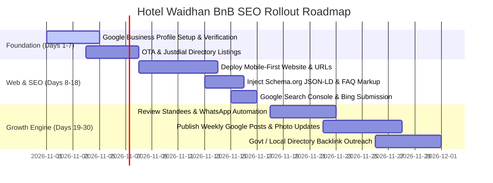

# Hotel Waidhan BnB: Local SEO & Google Search Domination Playbook
## The Comprehensive Master Guide to Dominating Google Maps (Local 3-Pack), Organic SERP, OTAs, and Directory Citations in Waidhan & Singrauli

---

## Table of Contents
1. [Executive Summary & Strategic Overview](#1-executive-summary--strategic-overview)
2. [Market & Local Intelligence: Waidhan & Singrauli](#2-market--local-intelligence-waidhan--singrauli)
3. [Competitor Breakdown & Vulnerability Matrix](#3-competitor-breakdown--vulnerability-matrix)
4. [Google Business Profile (GBP) Domination Blueprint](#4-google-business-profile-gbp-domination-blueprint)
5. [OTA & Directory Citation Playbook](#5-ota--directory-citation-playbook)
6. [Website Information Architecture & Target Landing Pages](#6-website-information-architecture--target-landing-pages)
7. [On-Page SEO & Keyword Targeting Matrix](#7-on-page-seo--keyword-targeting-matrix)
8. [Technical SEO & Production Schema.org Markup (JSON-LD)](#8-technical-seo--production-schemaorg-markup-json-ld)
9. [Automated Review Generation & Keyword Flywheel](#9-automated-review-generation--keyword-flywheel)
10. [Conversion Optimization & Mobile-First UX](#10-conversion-optimization--mobile-first-ux)
11. [Regional Expansion Strategy (Morwa, Rewa, Sidhi)](#11-regional-expansion-strategy-morwa-rewa-sidhi)
12. [30-Day Step-by-Step Implementation Roadmap](#12-30-day-step-by-step-implementation-roadmap)

---

## 1. Executive Summary & Strategic Overview

Hotel Waidhan BnB is positioned to capture the entire spectrum of accommodation search volume in the Singrauli district:
- **Ultra-Budget / Transit Seekers:** Cheapest rooms, single beds, lodges, and dormitories.
- **Monthly / Extended Stay:** Paying Guest (PG) accommodations for students, interns, engineers, and workers.
- **Corporate / VIP / Executive Stays:** Deluxe AC rooms with high-speed Wi-Fi, desks, and premium room service.

### The Opportunity
In tier-2/tier-3 industrial hubs like Waidhan/Singrauli, existing hotels rely almost entirely on offline walk-ins, basic Justdial listings, and outdated Google Business Profiles. **Virtually no competitor operates an SEO-optimized, schema-enabled, mobile-first website or a proactive review collection engine.** By implementing this playbook, Hotel Waidhan BnB can realistically achieve:
1. **#1 Rank in the Google Local 3-Pack** for hyper-local queries within 45–60 days.
2. **Top-3 Organic SERP Rankings** alongside MakeMyTrip and Justdial for high-intent long-tail keywords.
3. **Zero-Commission Direct Bookings** via WhatsApp and Direct Calling.

---

## 2. Market & Local Intelligence: Waidhan & Singrauli

To win local search, you must understand the geographic and commercial search behavior of your audience:

### Key Demand Generators:
1. **The Energy Capital Hub:**
   - **NTPC Vindhyanagar** (Vindhyachal Super Thermal Power Station) — ~10 km from Waidhan.
   - **NCL (Northern Coalfields Limited)** Headquarters (Panjreh) and major open-cast mines (Jayant, Nigahi, Dudhichua, Bina, Khadia).
   - **Mega Projects:** Sasan Power (Reliance UMPP), Essar Power Mahan, Hindalco Aluminium.
   - *Search Behavior:* Corporate visitors, technical auditors, vendor contractors, machine maintenance engineers needing clean AC rooms, GST invoices, and fast Wi-Fi.
2. **Administrative & Legal Center:**
   - Waidhan is the official district headquarters of Singrauli (District Collectorate, District Court, SP Office, RTO).
   - *Search Behavior:* Government officers, lawyers, litigants, and applicants seeking rooms near Ambedkar Chowk or the Collectorate.
3. **Transit Corridors:**
   - **Waidhan Bus Stand:** The focal point for intra-district and inter-district state buses (Rewa, Sidhi, Varanasi, Ambikapur).
   - **Singrauli Railway Station (Morwa):** Located ~16 km away.
   - **Shaktinagar Railway Station:** Located ~12 km away across the UP border.
   - *Search Behavior:* Travelers getting off buses late at night searching on mobile: *"cheapest room near waidhan bus stand"* or *"hotel room under 500 in waidhan"*.
4. **Students & Job Aspirants:**
   - Polytechnic institutes, coaching centers, MP government recruitment exams, NCL operator/apprentice exam centers.
   - *Search Behavior:* *"PG in Waidhan"*, *"dormitory bed in Waidhan"*, *"cheapest room for rent"*.

---

## 3. Competitor Breakdown & Vulnerability Matrix

| Competitor Name | Primary Channels | Estimated Reviews | Strengths | Vulnerabilities (Your Advantage) |
| :--- | :--- | :--- | :--- | :--- |
| **Hotel The Grand Agastya** | Google Maps, MMT, Agoda | 300+ (4.1★) | Perceived modern upscale property, dining/bar | Expensive; does not target budget travelers, dormitories, or PGs. Weak website SEO. |
| **Singrauli Palace Heritage** | Google Maps, Booking.com | 250+ (3.9★) | Heritage branding, swimming pool, garden | High tariffs; no dormitory or budget options; slow website response. |
| **Hotel Satya International** | Google Maps, MMT, Justdial | 350+ (3.8★) | Prime Bilauji location; established corporate reputation | Older infrastructure; reviews cite outdated bathrooms; zero content marketing. |
| **Hotel Pratap & Restaurant** | Google Maps, Justdial | 150+ (3.9★) | Opposite Malhaar Park / Bus Stand; strong budget walk-in traffic | No standalone website; no structured schema; no online booking engine. |
| **Hotel JD Palace / Udika** | Google Maps, Justdial | 100+ (3.8★) | Nawanagar Road / Thana Road presence; low room tariffs | Poor digital presence; no review management; zero optimization for PG/dormitory terms. |
| **Ashish PG / Local Hostels** | Justdial, MagicBricks, OLX | <20 (3.5★) | Captures student long-term searches | Unorganized; no instant booking; no daily stay options. |

### The Winning Edge for Hotel Waidhan BnB:
No competitor covers the **entire customer spectrum** (Dormitory ₹399 -> Budget Private ₹699 -> Executive AC ₹1,499 -> Monthly PG ₹5,500). By bundling these on one authoritative platform with structured data, you capture 100% of the long-tail search volume.

---

## 4. Google Business Profile (GBP) Domination Blueprint

Google Business Profile drives over 70% of inbound calls and map directions for hospitality businesses.

### 1. Profile Title & Naming
* **Recommended Name:** `Hotel Waidhan BnB - Budget Rooms, PG & Dormitory`
* *Guideline:* Keep the primary brand visible while integrating the high-volume category triggers (*Budget Rooms, PG & Dormitory*).

### 2. Category Configuration
* **Primary Category:** `Hotel` or `Bed & Breakfast`
* **Additional Categories (Add all):**
  - `Budget Japanese Inn / Budget Hotel`
  - `Paying Guest Accommodation`
  - `Hostel` (signals dormitory / per-bed stays)
  - `Lodge`
  - `Extended Stay Hotel`
  - `Motel`

### 3. Pin Accuracy & Service Areas
* Set the map pin accurately at your entrance.
* **Service Areas:** Select *Waidhan, Singrauli, Vindhyanagar, Morwa, Jayant, Nigahi, Dudhichua, Shaktinagar*.

### 4. Attributes & Amenities Setup (Check every applicable box)
* **Internet:** Free Wi-Fi (Speed: 50+ Mbps if available).
* **Policies:** 24-hour check-in, Couple-friendly (ID required), Family-friendly.
* **Room Amenities:** Air conditioning, Daily housekeeping, Room service, Hot water / Geyser, Power backup.
* **Accessibility:** Ground floor rooms, accessible parking.
* **Parking:** Free on-site parking for two-wheelers and four-wheelers.

### 5. Services & Products Catalog
Configure rich product cards inside GBP with direct pricing and photos:
1. **Dormitory Single Bed:** *Starting at ₹399/night* (Includes clean bedding, locker, charging socket, shared washroom).
2. **Standard Non-AC Economy Room:** *Starting at ₹699/night* (Double bed, attached bathroom, TV, Wi-Fi).
3. **Deluxe AC Executive Room:** *Starting at ₹1,199/night* (Split AC, clean linen, hot shower, work desk, room service).
4. **VIP Suite Room:** *Starting at ₹1,799/night* (Large executive space, premium mattress, Smart TV, tea/coffee kit).
5. **Monthly PG Package:** *Starting at ₹5,500/month* (For students and corporate personnel; includes food options and housekeeping).

### 6. Weekly Google Posts Strategy
Post 2 Google Updates every week with high-res photos and keyword-optimized captions:
- *Post 1 (Mid-week):* "Visiting NTPC Vindhyanagar or NCL Singrauli this week? Get executive AC rooms with high-speed Wi-Fi and GST invoicing at Hotel Waidhan BnB. Call now!"
- *Post 2 (Weekend):* "Looking for the cheapest clean room or dormitory bed near Waidhan Bus Stand? Beds starting at ₹399! Walk in or reserve via WhatsApp."

---

## 5. OTA & Directory Citation Playbook

Search engines cross-reference your Name, Address, and Phone (**NAP**) across all major directories to determine local search authority. Ensure 100% spelling consistency across all platforms.

```text
Name: Hotel Waidhan BnB
Address: Near Bus Stand, Ambedkar Chowk, Waidhan, District Singrauli, Madhya Pradesh - 486886
Phone Lines: +91-7879028316 (Primary & WhatsApp), +91-9770236735 (Corporate/PG), +91-9109302812 (Banquet/Events)
Website: https://hotelwaidhanbnb.com
```

### Registration Channels:

### Tier 1: Online Travel Agencies (OTAs)
1. **MakeMyTrip & Goibibo (IngoMMT Partner Portal):**
   - Mandatory for business travelers from Delhi, Mumbai, Bhopal, and Varanasi.
   - List separate room tiers (Economy, Deluxe, Executive).
2. **Agoda & Booking.com Partner Hub:**
   - Feeds Google Hotel Search price comparison feeds.
3. **Airbnb:**
   - Register as "Boutique Stay & BnB in Waidhan Singrauli" — attracts long-stay corporate engineers and tourists visiting Mada Caves.

### Tier 2: Indian High-DA Business Directories
1. **Justdial (Waidhan / Singrauli):**
   - Create a verified listing under *Hotels*, *Budget Hotels*, *Lodges*, *PG Accommodations*, and *Dormitories*.
   - Upload 25+ photos of clean rooms, exterior, washrooms, and reception.
2. **IndiaMART & TradeIndia:**
   - Register a company profile. Corporate contractors looking to house 10–50 workers for plant shutdowns search IndiaMART for bulk room rates.
3. **Sulekha:**
   - List under *Hostels & Paying Guest (PG) in Singrauli*.

### Tier 3: Real Estate & Rental Portals (For PG/Monthly Bookings)
1. **MagicBricks:** Create a listing under *PG in Waidhan Singrauli*.
2. **99acres:** List under *Furnished Room / PG for rent in Waidhan*.
3. **OLX India:** Refresh an ad every 14 days for: *"Furnished PG / Budget Room in Waidhan near Bus Stand"*.

### Tier 4: Government & Local Tourism Authority
- Submit hotel details to the **Singrauli District Administration portal** (`singrauli.nic.in`) under Tourism > Hotel & Lodging. A backlink from `.nic.in` is an unbeatable local ranking signal.

---

## 6. Website Information Architecture & Target Landing Pages

A single homepage cannot rank for every search intent. Implement this siloed URL structure:

```text
hotelwaidhanbnb.com/
│
├── /                                         [Main Entity: Best Hotel & BnB in Waidhan]
├── /cheapest-rooms-in-waidhan/               [Target: Budget travelers, price searchers]
├── /dormitory-waidhan/                       [Target: Single bed, daily transit, backpacker]
├── /pg-in-waidhan/                           [Target: Monthly student & corporate PG]
├── /vip-deluxe-rooms/                        [Target: Premium, VIP, Executive AC stays]
│
├── /locations/
│   ├── /hotels-near-waidhan-bus-stand/       [Transit keyword anchor]
│   ├── /hotels-near-ntpc-vindhyanagar/       [Corporate NTPC vendor target]
│   ├── /hotels-near-ncl-singrauli/           [NCL headquarters & coal mines target]
│   └── /hotels-near-singrauli-railway-station/ [Railway transit target]
│
└── /expansion/
    ├── /budget-hotels-in-morwa/              [Sub-hub expansion]
    ├── /budget-hotels-in-rewa/               [Regional corridor]
    └── /budget-hotels-in-sidhi/              [Regional corridor]
```

---

## 7. On-Page SEO & Keyword Targeting Matrix

### Core Keyword Clusters:

| Target Query | Search Intent | Target URL | Primary H1 |
| :--- | :--- | :--- | :--- |
| `cheapest hotel in waidhan` / `cheapest room in waidhan singrauli` | Ultra-Budget | `/cheapest-rooms-in-waidhan/` | Cheapest Hotel Rooms & Budget Stays in Waidhan |
| `dormitory in waidhan` / `dormitory bed singrauli` | Backpacker / Transit | `/dormitory-waidhan/` | Clean & Affordable Dormitory Accommodation in Waidhan |
| `pg in waidhan` / `paying guest in waidhan singrauli` | Long-Stay / Student | `/pg-in-waidhan/` | Best PG Accommodation in Waidhan for Boys & Girls |
| `best hotel in waidhan` / `luxury room waidhan singrauli` | Executive / Premium | `/vip-deluxe-rooms/` | Premium VIP Deluxe & Executive AC Rooms in Waidhan |
| `hotels near waidhan bus stand` | Hyper-Local Transit | `/locations/hotels-near-waidhan-bus-stand/` | Budget & Luxury Hotels Near Waidhan Bus Stand |
| `hotels near ntpc vindhyanagar` | Industrial Corporate | `/locations/hotels-near-ntpc-vindhyanagar/` | Comfortable Stays & Hotels Near NTPC Vindhyanagar |

---

### Exact Metadata Blueprints:

#### 1. Homepage (`/`)
* **Title:** `Hotel Waidhan BnB | Best Hotel, Budget Rooms, PG & Dormitory in Waidhan Singrauli`
* **Meta Description:** `Looking for the best hotel or cheapest room in Waidhan, Singrauli? Hotel Waidhan BnB offers AC VIP rooms, budget stays, dormitory beds & PG options. Free Wi-Fi, 24/7 power backup. Book direct for best rates!`
* **H1:** `Hotel Waidhan BnB – Your Trusted Stay in Waidhan, Singrauli`
* **H2s:**
  - `Budget Rooms, Executive AC Suites & Dormitory Stays`
  - `Conveniently Located Near Waidhan Bus Stand & NTPC Vindhyanagar`
  - `Why Travelers & Corporate Executives Choose Hotel Waidhan BnB`
  - `Frequently Asked Questions (FAQ)`

#### 2. Cheapest Rooms Landing Page (`/cheapest-rooms-in-waidhan/`)
* **Title:** `Cheapest Rooms & Budget Lodge in Waidhan Singrauli | From ₹499`
* **Meta Description:** `Book the cheapest rooms in Waidhan Singrauli starting at ₹499. Clean rooms, attached washroom, 24/7 hot water, high-speed Wi-Fi, and complete security. Call now for instant booking.`
* **H1:** `Cheapest Hotel Rooms & Budget Lodging in Waidhan`
* **Key Content Elements:**
  - Comparison table: "Local Unregistered Lodges vs. Hotel Waidhan BnB" (highlight hygiene, backup power, security).
  - Clear rate card (Non-AC Single, Non-AC Double).
  - Prominent WhatsApp "Book for ₹499" sticky button.

#### 3. Dormitory Landing Page (`/dormitory-waidhan/`)
* **Title:** `Dormitory in Waidhan Singrauli | Clean Single Bed Stay from ₹399/Day`
* **Meta Description:** `Searching for dormitory accommodation in Waidhan? Hotel Waidhan BnB offers hygienic single bed dormitory spaces with lockers, Wi-Fi, clean washrooms, and charging points.`
* **H1:** `Hygienic & Affordable Dormitory Accommodation in Waidhan`
* **Key Content Elements:**
  - Photos of clean bunks/beds with fresh linen.
  - Highlights: Individual luggage lockers, personal reading lamp, charging points, filtered drinking water, 24/7 CCTV surveillance.

#### 4. PG Landing Page (`/pg-in-waidhan/`)
* **Title:** `Best PG in Waidhan Singrauli for Boys & Working Men | Monthly Stay & Food`
* **Meta Description:** `Affordable PG in Waidhan with home-style food, high-speed Wi-Fi, RO water, and daily cleaning. Ideal for NTPC/NCL employees, interns, and students. Check available rooms today.`
* **H1:** `Fully Furnished Paying Guest (PG) Accommodation in Waidhan`
* **Key Content Elements:**
  - Monthly rent breakdown (Single room, double sharing, triple sharing).
  - Food menu highlights (Breakfast, Lunch, Dinner options).
  - Distance chart to key coaching institutes and company sites.

---

## 8. Technical SEO & Production Schema.org Markup (JSON-LD)

Place the following comprehensive Schema markup inside the `<head>` of your website. This tells Google that you operate as a Hotel, BedAndBreakfast, and Hostel simultaneously, and triggers rich FAQ accordions on Google Search results.

```html
<script type="application/ld+json">
{
  "@context": "https://schema.org",
  "@graph": [
    {
      "@type": ["Hotel", "BedAndBreakfast", "Hostel"],
      "@id": "https://hotelwaidhanbnb.com/#lodging",
      "name": "Hotel Waidhan BnB",
      "alternateName": ["Waidhan BnB", "Hotel Waidhan", "Hotel Waidhan Bed and Breakfast"],
      "description": "Hotel Waidhan BnB offers premier accommodation in Waidhan, Singrauli including budget rooms, VIP deluxe suites, PG accommodations, and clean dormitory beds.",
      "url": "https://hotelwaidhanbnb.com",
      "telephone": ["+91-7879028316", "+91-9770236735", "+91-9109302812"],
      "email": "booking@hotelwaidhanbnb.com",
      "priceRange": "₹399 - ₹2499",
      "currenciesAccepted": "INR",
      "paymentAccepted": "Cash, UPI, Credit Card, Debit Card, Net Banking",
      "checkinTime": "12:00",
      "checkoutTime": "11:00",
      "petsAllowed": false,
      "address": {
        "@type": "PostalAddress",
        "streetAddress": "Near Bus Stand, Main Road",
        "addressLocality": "Waidhan",
        "addressRegion": "Madhya Pradesh",
        "postalCode": "486886",
        "addressCountry": "IN"
      },
      "geo": {
        "@type": "GeoCoordinates",
        "latitude": 24.0625,
        "longitude": 82.6288
      },
      "hasMap": "https://maps.google.com/?cid=YOUR_GBP_CID_NUMBER",
      "amenityFeature": [
        { "@type": "LocationFeatureSpecification", "name": "Free High-Speed Wi-Fi", "value": true },
        { "@type": "LocationFeatureSpecification", "name": "Air Conditioning", "value": true },
        { "@type": "LocationFeatureSpecification", "name": "24/7 Power Backup", "value": true },
        { "@type": "LocationFeatureSpecification", "name": "Hot & Cold Running Water", "value": true },
        { "@type": "LocationFeatureSpecification", "name": "Dormitory Beds", "value": true },
        { "@type": "LocationFeatureSpecification", "name": "On-Site Free Parking", "value": true },
        { "@type": "LocationFeatureSpecification", "name": "Room Service", "value": true },
        { "@type": "LocationFeatureSpecification", "name": "24-Hour Front Desk", "value": true }
      ],
      "containsPlace": [
        {
          "@type": "HotelRoom",
          "name": "Dormitory Single Bed",
          "description": "Clean single bed in a shared dormitory with personal charging socket and locker.",
          "occupancy": { "@type": "QuantitativeValue", "value": 1 }
        },
        {
          "@type": "HotelRoom",
          "name": "Budget Double Room",
          "description": "Economical non-AC room with attached private bathroom and television.",
          "occupancy": { "@type": "QuantitativeValue", "value": 2 }
        },
        {
          "@type": "HotelRoom",
          "name": "Deluxe AC Executive Room",
          "description": "Air-conditioned deluxe room with premium mattress, work desk, and 24/7 hot water.",
          "occupancy": { "@type": "QuantitativeValue", "value": 2 }
        }
      ]
    },
    {
      "@type": "FAQPage",
      "@id": "https://hotelwaidhanbnb.com/#faq",
      "mainEntity": [
        {
          "@type": "Question",
          "name": "What is the price of the cheapest room or dormitory in Waidhan?",
          "acceptedAnswer": {
            "@type": "Answer",
            "text": "At Hotel Waidhan BnB, clean dormitory beds start at ₹399 per day, and private budget economy rooms start at ₹699 per night with free Wi-Fi, clean linen, and 24/7 power backup."
          }
        },
        {
          "@type": "Question",
          "name": "Is paying guest (PG) accommodation available for monthly stay in Waidhan?",
          "acceptedAnswer": {
            "@type": "Answer",
            "text": "Yes, Hotel Waidhan BnB provides fully furnished monthly PG accommodation for working professionals, NTPC/NCL contractor engineers, and students, with optional home-style food services."
          }
        },
        {
          "@type": "Question",
          "name": "How far is Hotel Waidhan BnB from Waidhan Bus Stand and NTPC Vindhyanagar?",
          "acceptedAnswer": {
            "@type": "Answer",
            "text": "Hotel Waidhan BnB is situated within 5 minutes of Waidhan Bus Stand and Ambedkar Chowk, and approximately 10 km (15-20 minutes) from NTPC Vindhyanagar."
          }
        },
        {
          "@type": "Question",
          "name": "Do you provide AC deluxe rooms with GST invoices for corporate travelers?",
          "acceptedAnswer": {
            "@type": "Answer",
            "text": "Yes, we offer premium VIP and Deluxe AC executive rooms complete with high-speed Wi-Fi, working desks, room service, and verified GST tax invoices for business claims."
          }
        }
      ]
    }
  ]
}
</script>
```

---

## 9. Automated Review Generation & Keyword Flywheel

Reviews with search keywords (*"cheapest room"*, *"best hotel in waidhan"*, *"clean dormitory"*) are Google's #1 organic signal for local ranking.

### 1. Reception Counter Standee
Print an acrylic standee placed at the billing counter with a direct Google Review QR code:
> **"Enjoyed your stay at Hotel Waidhan BnB? Scan to share your feedback on Google and help fellow travelers!"**

### 2. Post-Checkout WhatsApp Automation
Trigger this WhatsApp message 1 hour after checkout:

```text
Namaste [Guest Name] ji 🙏,

Thank you for staying with us at Hotel Waidhan BnB!

We hope you enjoyed our clean rooms and hospital service. Could you please take 30 seconds to rate us on Google? It means the world to our local team:

👉 [Insert Direct Google Review Short Link]

(Tip: If you liked our budget rooms, dormitory beds, or location near Waidhan Bus Stand, feel free to mention it in your review!)

Have a safe journey ahead! 🚗🚆
Team Hotel Waidhan BnB
```

### 3. Review Response Strategy (Injecting Target Keywords)
Never just say "Thanks for the review." Reply using keyword rich responses:

* **When a guest praises budget/dormitory:**
  > *"Thank you [Name]! We take pride in providing the cleanest dormitory beds and cheapest budget rooms in Waidhan Singrauli. We look forward to welcoming you back whenever you visit Waidhan!"*
* **When a corporate guest leaves a review:**
  > *"Thank you for your valuable feedback, [Name]. We are pleased that our deluxe AC room, fast Wi-Fi, and proximity to NTPC Vindhyanagar suited your business trip. See you again at Hotel Waidhan BnB!"*

---

## 10. Conversion Optimization & Mobile-First UX

90%+ of budget room searches occur on mobile devices under weak network conditions (3G/4G).

### Key Website UX Requirements:
1. **Ultra-Fast Loading:** Keep the total page size under 800 KB using modern WebP images. Largest Contentful Paint (LCP) must be under 1.5 seconds.
2. **Persistent Floating CTA Bar (Mobile):**
   - Left Button: `📞 Call Now: +91-XXXXX`
   - Right Button: `💬 WhatsApp Booking (Instant Response)`
3. **Upfront Room Pricing:** Never hide room rates behind an inquiry wall. Showing transparent pricing (e.g., *₹399 Dormitory | ₹699 Budget | ₹1,199 Deluxe AC*) builds instant trust and stops travelers from returning to Google to search for competitors.
4. **Google Maps Embed:** Embed a live interactive Google Map on every page showing exact walking distance from Waidhan Bus Stand and driving distance from NTPC Vindhyanagar.

---

## 11. Regional Expansion Strategy (Morwa, Rewa, Sidhi)

As Hotel Waidhan BnB solidifies its position, create dedicated landing pages capturing connecting traveler traffic along the NH-39 corridor:

1. **Morwa (Singrauli Railway Station):**
   - URL: `/hotels-near-singrauli-railway-station/`
   - Content: Guide travelers arriving at Morwa Station on how to reach Waidhan (auto/bus routes) and offer pre-booked pickup coordination.
2. **Sidhi District (~80 km away):**
   - URL: `/budget-hotels-near-sidhi/`
   - Target travelers transiting between Sidhi and the Singrauli industrial belt.
3. **Rewa (~180 km away):**
   - URL: `/hotels-for-rewa-singrauli-travelers/`
   - Target regional sales executives and engineers traveling the Rewa-Singrauli commercial route.

---

## 12. 30-Day Step-by-Step Implementation Roadmap



### Detailed Daily Checklist:

#### Week 1: Identity & Profiles (Days 1 – 7)
- [ ] Claim or create the Google Business Profile as `Hotel Waidhan BnB - Budget Rooms, PG & Dormitory`.
- [ ] Complete 100% of GBP profile fields: Pin drop, business hours (24 hours), check-in/out times, and all attributes.
- [ ] Upload 30+ bright, high-resolution photos (Front facade, reception, dormitory bunks, private budget rooms, deluxe AC rooms, clean washrooms, parking).
- [ ] Create listings on **Justdial**, **IndiaMART**, and **Sulekha** using identical Name, Address, and Phone (NAP).
- [ ] Register on **MakeMyTrip / Goibibo IngoMMT** and **Booking.com**.

#### Week 2: Website Launch & Technical SEO (Days 8 – 15)
- [ ] Launch the official website with dedicated URLs for:
  - `/cheapest-rooms-in-waidhan/`
  - `/dormitory-waidhan/`
  - `/pg-in-waidhan/`
  - `/vip-deluxe-rooms/`
  - `/locations/hotels-near-waidhan-bus-stand/`
  - `/locations/hotels-near-ntpc-vindhyanagar/`
- [ ] Add the complete JSON-LD Structured Data Schema (`Hotel`, `BedAndBreakfast`, `Hostel`, `FAQPage`) to the site `<head>`.
- [ ] Verify website ownership on **Google Search Console** and submit the `sitemap.xml`.
- [ ] Add prominent Click-to-Call and WhatsApp floating booking buttons.

#### Week 3: The Review Engine & Directory Expansion (Days 16 – 22)
- [ ] Print acrylic Google Review QR code standees and place them at the reception desk.
- [ ] Set up the post-checkout WhatsApp review request script.
- [ ] Post ad listings on **MagicBricks**, **99acres**, and **OLX** targeting monthly PG and room rentals in Waidhan.
- [ ] Reach out to the Singrauli District portal administration to add your hotel to `singrauli.nic.in/en/tourism/hotel-and-lodging/`.

#### Week 4: Momentum & Local Ranking Surge (Days 23 – 30)
- [ ] Reach the first milestone of **25+ genuine 5-star Google Reviews** with keyword-rich owner responses.
- [ ] Publish 2 Google Posts per week with photos showcasing clean rooms and proximity to key landmarks.
- [ ] Audit search ranking progress on Google Maps for target terms: *"cheapest room in waidhan"*, *"hotels near waidhan bus stand"*, and *"pg in waidhan singrauli"*.
- [ ] Launch regional expansion landing pages for Morwa, Sidhi, and Rewa connecting travelers.

---

*Document created for Hotel Waidhan BnB. Keep this playbook active and review monthly metrics on Google Business Profile Insights and Google Search Console.*
